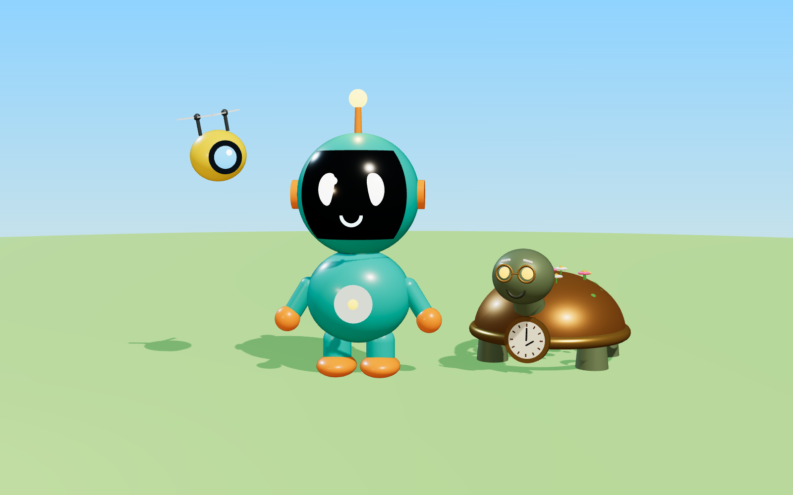

# donimodays: Channel Bible

## The big idea

Every video is **one day in the life of Donimo**, a small, curious robot who wants to
understand everything about Earth, people, and the future.

This one character ties every topic together. Comedy, motivation, mystery, future,
exploration, and daily news all become "Donimo's days". Viewers subscribe for the
character, not just the topic.

**Tagline:** *Every day is a new adventure.*

## Format rules

| Setting | Value |
| --- | --- |
| Aspect ratio | 9:16 vertical, 1080 x 1920 |
| Length | 15 to 45 seconds |
| Shots per video | 5 to 10, each 3 to 6 seconds |
| Hook | Something surprising in the first 2 seconds |
| Captions | Always on, big and centered |
| Ending | Payoff, twist, or cliffhanger. Never a slow fade |
| Visual style | Stylized 3D animation, soft cinematic lighting, bright colors |

## Characters

Use these renders as image references in your AI tool:

- `images/donimo-and-pip.png` is the main Donimo reference, in vertical format.
- `images/donimo-turnaround.png` shows Donimo from the front, three-quarter, side, and back.
- `images/characters-lineup.png` shows all three characters together.

Paste the **prompt block** of each character into every image or video prompt,
word for word. Never change the wording. This is what keeps characters consistent.

### Donimo (main character)

- **Personality:** curious, brave, a little clumsy, always optimistic.
- **Voice:** young, cheerful, slightly robotic.
- **Catchphrase:** "New day, new adventure!"

Prompt block:

> Donimo, a small cute round robot about knee height, glossy teal body, large
> round head with a black glass face screen showing two big glowing white oval
> eyes, short orange antenna with a glowing yellow bulb on top, small round arms
> and stubby legs, tiny orange backpack, stylized 3D animated character

### Pip (sidekick, comedy relief)

- **Personality:** hyper, loyal, panics easily. Speaks only in beeps.
- **Role:** reacts to everything. The audience laughs through Pip.

Prompt block:

> Pip, a tiny flying lemon-yellow drone the size of a tennis ball, round body,
> one big blue camera eye, two small spinning propellers on top, stylized 3D
> animated character

### Old Tock (mentor, motivation episodes)

- **Personality:** calm, wise, warm, speaks slowly.
- **Voice:** deep, gentle, elderly.

Prompt block:

> Old Tock, an old wise robot shaped like a turtle, weathered bronze metal shell
> with green moss and tiny flowers growing on it, round brass clock face on his
> chest, kind glowing amber eyes, small round spectacles, stylized 3D animated
> character

## Series

Each topic gets its own named series. Put the series name in the title and on the
first frame so viewers learn to recognize it.

| Topic | Series name | Formula |
| --- | --- | --- |
| Comedy | **Donimo Tries** | Donimo tries a normal human thing and it goes hilariously wrong |
| Motivation | **Old Tock Says** | Donimo is stuck or sad, Old Tock gives one simple lesson |
| Mystery | **Donimo Investigates** | A real unsolved mystery, three facts, end on a question |
| Future | **Year 2099** | Donimo shows what one everyday thing might look like in the future |
| Exploration | **Donimo Goes** | Donimo visits an amazing real place: deep sea, Mars, a volcano |
| Daily news | **Donimo Daily** | One real, interesting news story or fact in 30 seconds |

## Weekly schedule

| Day | Series |
| --- | --- |
| Monday | Old Tock Says |
| Tuesday | Donimo Tries |
| Wednesday | Donimo Investigates |
| Thursday | Year 2099 |
| Friday | Donimo Tries |
| Saturday | Donimo Goes |
| Sunday | Donimo Daily |

Comedy gets two days because it usually spreads fastest on Shorts.

## Production checklist for every video

1. Write the script and shot list.
2. Generate each shot as a separate clip using the character prompt blocks.
3. Generate 3 or 4 versions of each shot and keep the best one.
4. Record or generate the voice lines.
5. Add music and sound effects.
6. Edit, add captions, and check the first 2 seconds grab attention.
7. Upload as a Short with the series name in the title.
8. In YouTube's upload settings, check the altered or synthetic content setting.

## Rules for news, mystery, and exploration episodes

- Check every fact against at least two reliable sources before publishing.
- Clearly separate facts from Donimo's guesses or jokes.
- Never make AI footage look like real news footage of a real event.
