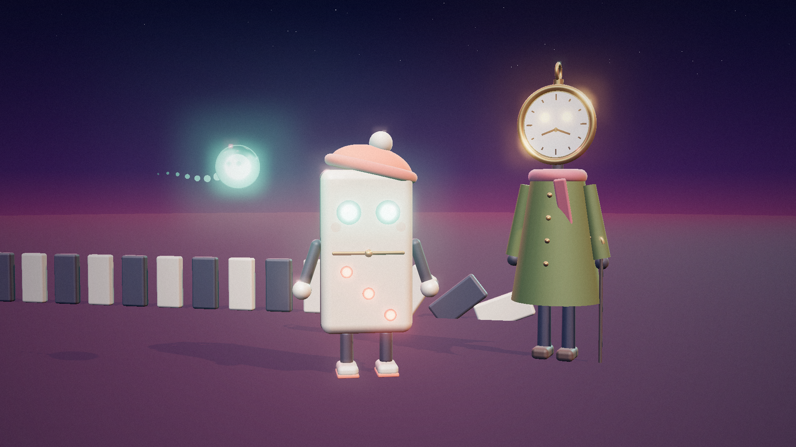
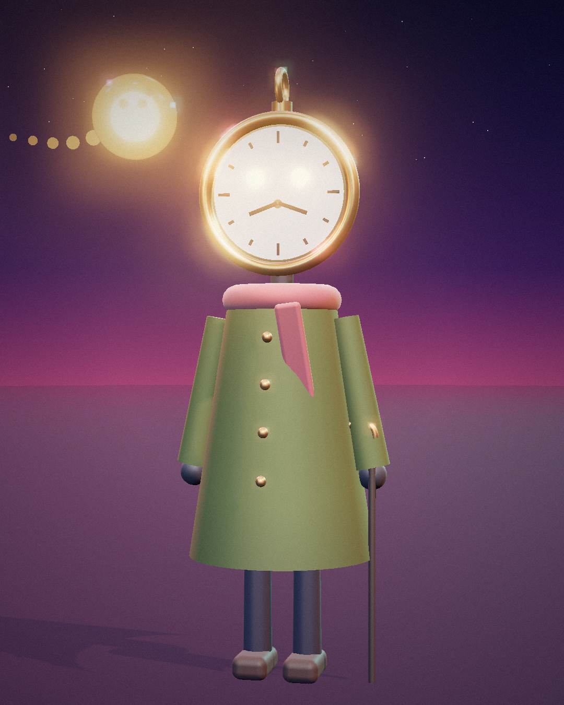

# donimodays: Channel Bible

## The big idea

Every video is **one day in the life of Donimo**, a living domino tile who wants to
understand everything about Earth, people, and the future.

This one character ties every topic together. Comedy, motivation, mystery, future,
exploration, and daily news all become "Donimo's days". Viewers subscribe for the
character, not just the topic.

**Tagline:** *One push. Big day.*

## Format rules

| Setting | Value |
| --- | --- |
| Aspect ratio | 9:16 vertical, 1080 x 1920 |
| Length | 15 to 45 seconds |
| Shots per video | 5 to 10, each 3 to 6 seconds |
| Hook | Something surprising in the first 2 seconds |
| Captions | Always on, big and centered |
| Ending | Payoff, twist, or cliffhanger. Never a slow fade |
| Visual style | Stylized 3D animation, soft cinematic lighting, bright colors |

## Characters

### The design idea

**donimodays sounds like "domino days".** So the whole world is built on dominoes:
one small push starts a chain reaction. Every episode is one domino falling into the
next. That gives the channel a symbol nobody else has, and a story engine that fits
every topic: one small action, big consequences.

### Visual style: "Dusk Lo-Fi"

The channel always looks like the magic hour just after sunset: soft, warm, a little
dreamy. Characters feel like premium vinyl collectible toys.

| Element | Rule |
| --- | --- |
| Sky | Deep indigo at the top, fading through plum and rose to peach at the horizon |
| Light | Warm sunset key light from behind, cool blue fill from the front, pink rim light on edges |
| Glow | Only eyes, pips, and Pip glow. Everything else stays matte |
| Materials | Matte porcelain, soft knit fabric, brushed brass. Never shiny plastic |
| Finish | Light film grain and a soft dark vignette on every frame |
| Brand motif | A line of cream and navy dominoes somewhere in the background |

| Color | Hex | Used for |
| --- | --- | --- |
| Ink navy | `#1B1F3B` | Donimo's back, limbs, deep shadows |
| Warm cream | `#E9D6B8` | Donimo's face, sneakers |
| Coral | `#FF6B57` | Beanie, accents, mood pips |
| Mint glow | `#6FF7D2` | Donimo's eyes, Pip |
| Brass gold | `#D8A657` | Divider line, Old Tock |
| Olive | `#55613A` | Old Tock's coat |
| Dusk plum | `#3A2547` | Ground and shadows |

### Donimo (main character)

Donimo is a **living domino tile** who woke up one morning and decided to explore
the world, one day at a time.

- **Look:** a tall rounded domino tile. Cream porcelain front, ink-navy back speckled
  with tiny stars. A thin brass line divides the face. The top half has two glowing
  mint eyes set into dark sockets. The bottom half has glowing pips.
- **Signature detail, the mood pips:** the pips on Donimo's belly change with his mood.
  One pip means shocked, two means sleepy or sad, three means calm, six means
  hyped. Eye shapes change too: dots, happy arcs, shocked rings, sleepy lines.
- **Outfit:** a slouchy coral knit beanie tilted to one side, cream sneakers with
  coral soles.
- **Personality:** curious, brave, a little clumsy. He tips over when surprised,
  like a domino, then catches himself.
- **Catchphrase:** "One push. Big day."

Prompt block:

> Donimo, a cute living domino tile character, tall rounded rectangle body, matte
> warm cream porcelain front and ink navy back with tiny star speckles, thin brushed
> brass line across the middle of the face, two large glowing mint-green round eyes
> set in dark circular sockets in the upper half, glowing coral domino pips on the
> lower half, soft pink blush cheeks, slouchy coral knit beanie with cream pom-pom
> tilted to one side, slim ink navy arms and legs, cream mitten hands, cream
> sneakers with coral soles, designer vinyl toy aesthetic

### Pip (sidekick)

Pip is **one of Donimo's pips that escaped** and came alive: a tiny glowing orb that
floats beside him, trailing sparkles. It never speaks. It blinks, changes color, and
zips around. Mint means happy, amber means curious, red means danger.

Prompt block:

> Pip, a tiny floating glowing orb the size of a tennis ball, clear glass shell with
> a bright mint-green light core inside, two small dark dot eyes, a short trail of
> fading glowing sparkles behind it, soft light bloom

### Old Tock (mentor)

Old Tock is a **wandering gentleman with an antique pocket watch for a head**. He has
seen every day there ever was, and he knows that every moment counts.

- **Look:** a brass pocket-watch head with a cream clock face, two softly glowing
  amber eyes, and clock hands that move with his expressions. A crown and ring sit on
  top like a tiny hat. He wears a long olive wool coat with brass buttons, a dusty
  rose scarf, dark trousers, worn leather boots, and carries a thin cane.
- **Personality:** calm, kind, speaks slowly. His clock hands tick when he thinks.
- **Catchphrase:** "Every second is a domino."

Prompt block:

> Old Tock, a tall gentle character with an antique brass pocket watch for a head,
> cream clock face with fine tick marks, two softly glowing amber eyes on the clock
> face, clock hands in the center, small brass crown and ring on top of the head,
> long olive green wool coat with brass buttons, dusty rose knit scarf, dark navy
> trousers, worn brown leather boots, thin dark wooden cane, designer vinyl toy
> aesthetic

### Style line for every prompt

Add this to the end of every image and video prompt:

> stylized 3D animation, designer vinyl toy aesthetic, dusk lo-fi mood, magic hour
> after sunset, indigo to peach gradient sky, warm rim light, soft volumetric haze,
> gentle glow on eyes only, matte materials, subtle film grain, shallow depth of
> field, cinematic, vertical 9:16

## Series

Each topic gets its own named series. Put the series name in the title and on the
first frame so viewers learn to recognize it.

| Topic | Series name | Formula |
| --- | --- | --- |
| Comedy | **Donimo Tries** | Donimo tries a normal human thing and it goes hilariously wrong |
| Motivation | **Old Tock Says** | Donimo is stuck or sad, Old Tock gives one simple lesson |
| Mystery | **Donimo Investigates** | A real unsolved mystery, three facts, end on a question |
| Future | **Year 2099** | Donimo shows what one everyday thing might look like in the future |
| Exploration | **Donimo Goes** | Donimo visits an amazing real place: deep sea, Mars, a volcano |
| Daily news | **Donimo Daily** | One real, interesting news story or fact in 30 seconds |

## Weekly schedule

| Day | Series |
| --- | --- |
| Monday | Old Tock Says |
| Tuesday | Donimo Tries |
| Wednesday | Donimo Investigates |
| Thursday | Year 2099 |
| Friday | Donimo Tries |
| Saturday | Donimo Goes |
| Sunday | Donimo Daily |

Comedy gets two days because it usually spreads fastest on Shorts.

## Production checklist for every video

1. Write the script and shot list.
2. Generate each shot as a separate clip using the character prompt blocks.
3. Generate 3 or 4 versions of each shot and keep the best one.
4. Record or generate the voice lines.
5. Add music and sound effects.
6. Edit, add captions, and check the first 2 seconds grab attention.
7. Upload as a Short with the series name in the title.
8. In YouTube's upload settings, check the altered or synthetic content setting.

## Rules for news, mystery, and exploration episodes

- Check every fact against at least two reliable sources before publishing.
- Clearly separate facts from Donimo's guesses or jokes.
- Never make AI footage look like real news footage of a real event.
